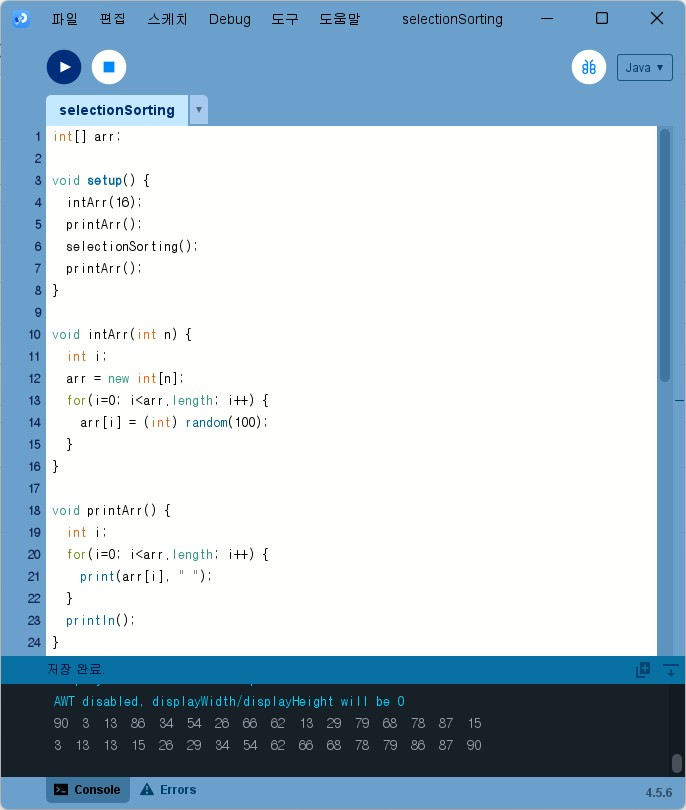
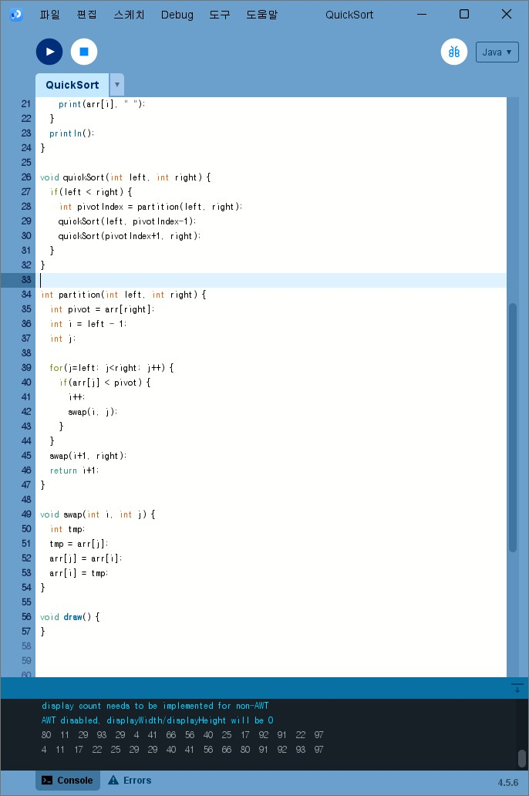
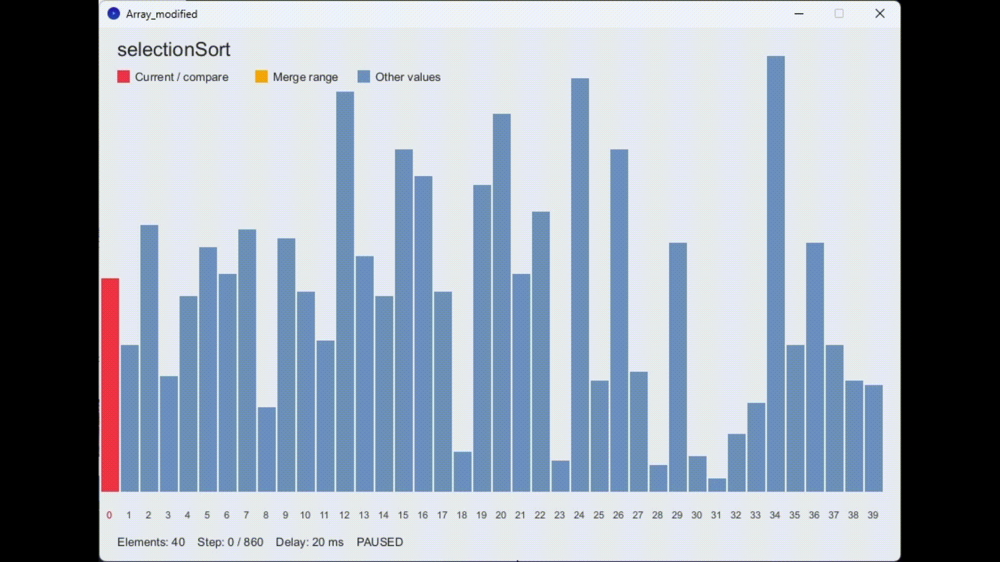
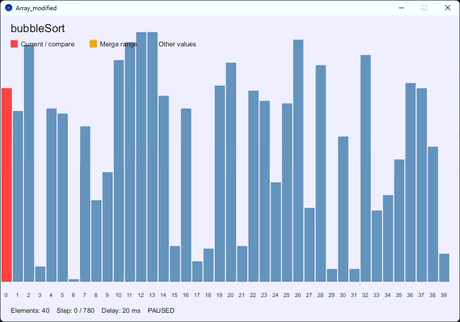
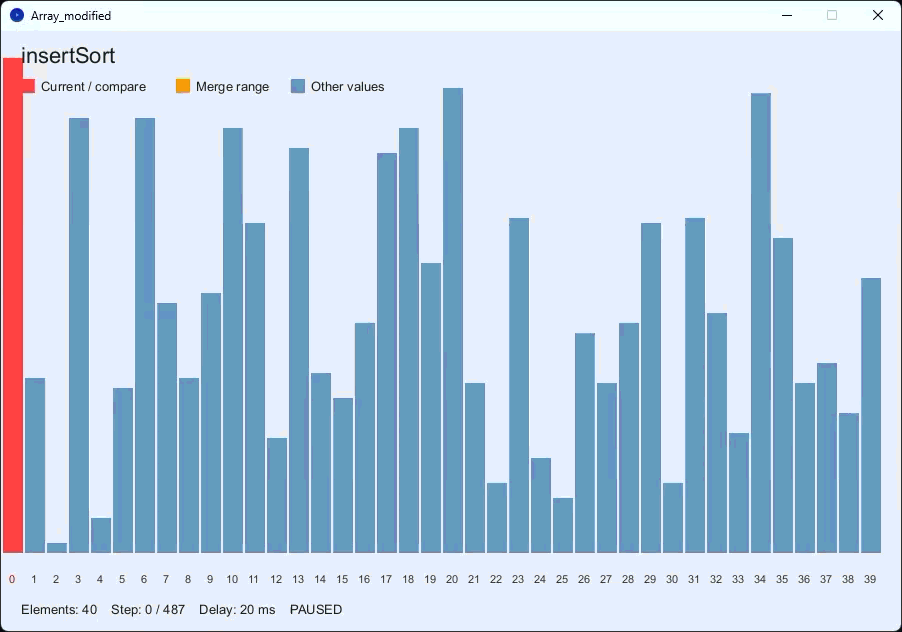
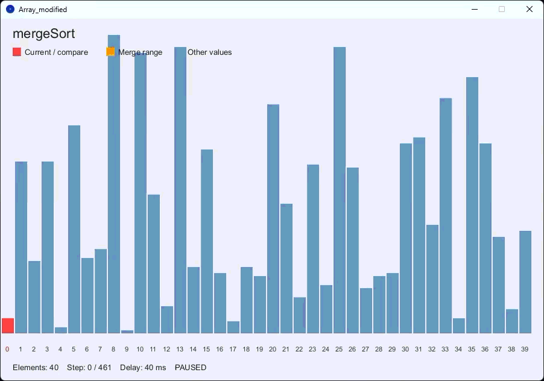
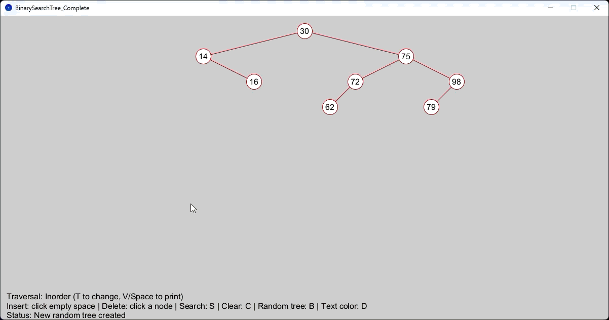
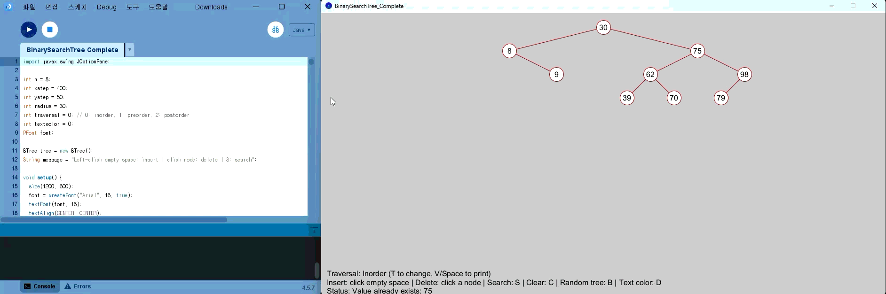

# Algorithm2026
### Homework1

[SelectionSorting](./homework/homework1/selectionSorting.pde)

[BubbleSorting](./homework/homework1/BubbleSorting.pde)

[InsertionSort](./homework/homework1/InsertionSort.pde)

[MergeSort](./homework/homework1/MergeSort.pde)

[QuickSort](./homework/homework1/QuickSort.pde)

[HeapSort](./homework/homework1/HeapSort.pde)

### Homework2

[SortAnimation](./homework/homework2/SortAnimation.pde)
[Array](./homework/homework2/Array.pde)

### Homework3

[BinarySearchTree](./homework/homework3/BinarySearchTree.pde)

